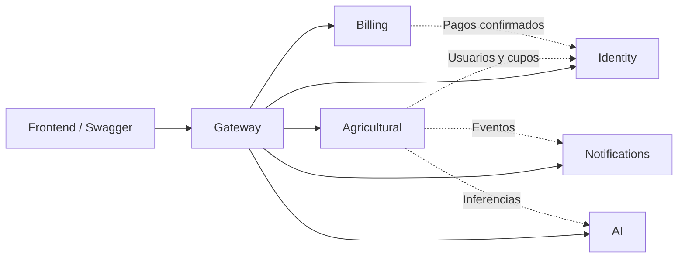

<div align="center">

# 🌱 AgroCloud Backend

**Gestión de calidad agrícola y poscosecha mediante microservicios.**

[](https://laravel.com/)
[](https://nestjs.com/)
[](https://fastapi.tiangolo.com/)
[](https://cloud.google.com/run)

**[Documentación](docs/README.md)** · **[Arquitectura](docs/architecture/overview.md)** · **[Guía local](docs/local-development.md)** · **[Despliegue](docs/deployment/cloud-run.md)**

</div>

---

## ¿Qué es AgroCloud?

AgroCloud es un backend modular para administrar **empresas, productores, lotes, muestreos, inspecciones y dictámenes de calidad**. Integra análisis de imágenes mediante IA, notificaciones y gestión de suscripciones.

Cada microservicio tiene una responsabilidad y sus propios datos. **Gateway** es el punto de entrada para los clientes.

## Microservicios

| Servicio | Tecnología | Responsabilidad |
| :-- | :-- | :-- |
| **Gateway** | NestJS | Enrutamiento, Swagger y entrada HTTP |
| **Identity** | Laravel | Autenticación, empresas, usuarios, permisos y planes |
| **Agricultural** | Laravel | Productores, lotes, muestreos, inspecciones y calidad |
| **Notifications** | NestJS | Bandeja, preferencias y eventos |
| **Billing** | NestJS | Órdenes, pagos, reembolsos y Culqi |
| **AI** | FastAPI | Análisis técnico de imágenes con Roboflow |

**Persistencia:** PostgreSQL para Identity, Agricultural, Notifications y AI; MongoDB para Billing. Las imágenes y evidencias se integran con Cloudinary según su servicio.

## Arquitectura



> Los servicios internos están diseñados para permanecer privados; Gateway gestiona el acceso externo. La autorización del usuario se valida en el microservicio correspondiente.

## Inicio rápido en local

**Requisito:** Docker Compose v2.

```bash
cp .env.example .env
# Completa las variables y los secretos requeridos en .env.
docker compose -f compose.yaml up -d postgres mongo
docker compose -f compose.yaml build
```

Antes de iniciar las APIs y workers, genera las claves RSA y aplica las migraciones indicadas en la **[guía de desarrollo local](docs/local-development.md)**.

## API y Swagger

| Ruta de Gateway | Uso |
| :-- | :-- |
| `GET /` | Información de servicios |
| `GET /health` | Salud de Gateway |
| `GET /docs` | Swagger UI interactivo |
| `GET /openapi.json` | Contrato OpenAPI agregado |
| `/api/v1/{servicio}/...` | Acceso a las rutas del microservicio |

Swagger documenta las operaciones orientadas a clientes. Para probar rutas protegidas, inicia sesión en **Identity** y utiliza **Authorize** con tu JWT. Las operaciones internas y las claves de servicio no deben exponerse al navegador.

**[Estándar de la API](docs/architecture/api-standard.md)** · **[Contratos OpenAPI](packages/contracts/openapi/)**

## Estado del proyecto

- ✅ Seis servicios desplegados en **Cloud Run** para pruebas de integración.
- ✅ Gateway y endpoints de salud verificados.
- 🧪 En validación: autenticación entre servicios, operaciones de negocio, workers y flujos completos de IA/pagos.

**Desplegado no significa validado para producción.** Consulta [Cloud Run](docs/deployment/cloud-run.md) para los controles pendientes.

## Documentación

Consulta el **[índice de documentación](docs/README.md)** para arquitectura, bases de datos, desarrollo local y despliegue.

---

<div align="center"><sub>AgroCloud · Backend de servicios · 2026</sub></div>
