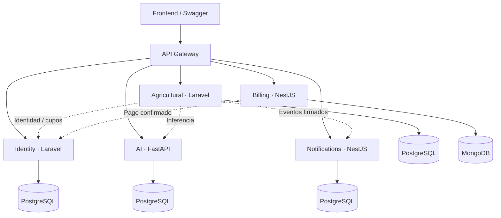

# 🏗️ Arquitectura

AgroCloud utiliza **seis servicios independientes**, conectados mediante HTTP y eventos. Gateway recibe las peticiones externas; los demás servicios conservan la lógica y los datos de cada dominio.

## Responsabilidades

| Servicio | Función principal |
| :-- | :-- |
| **Gateway** | Proxy HTTP, CORS y Swagger centralizado |
| **Identity** | Usuarios, empresas, sesiones, permisos, suscripciones y cupos |
| **Agricultural** | Proceso agrícola: recepción → lote → muestreo → inspección → dictamen |
| **AI** | Inferencias técnicas, detecciones y resultados de imágenes |
| **Notifications** | Eventos, bandeja, preferencias y entregas |
| **Billing** | Órdenes, cargos Culqi, conciliación y reembolsos |

## Comunicación y seguridad

- **Usuario → Gateway:** JWT Bearer emitido por Identity cuando la operación lo requiere.
- **Servicio → servicio privado:** permisos IAM y token de identidad de Cloud Run; las credenciales propias de aplicación se validan por separado.
- **Eventos:** firmas HMAC e idempotencia para evitar duplicados.
- **Datos:** cada servicio administra su base; no existen claves foráneas entre microservicios.

Los workers de Agricultural y Notifications procesan tareas persistidas. Billing puede despachar su outbox mediante un proceso o invocación programada. No se utiliza un broker central.

## Estado de despliegue

El entorno de **Google Cloud Run** dispone de los seis servicios y verificaciones básicas de salud. Siguen pendientes las pruebas completas de autorización, procesamiento asíncrono, pagos e IA. Consulta [Despliegue](../deployment/cloud-run.md).

[← Documentación](../README.md)
