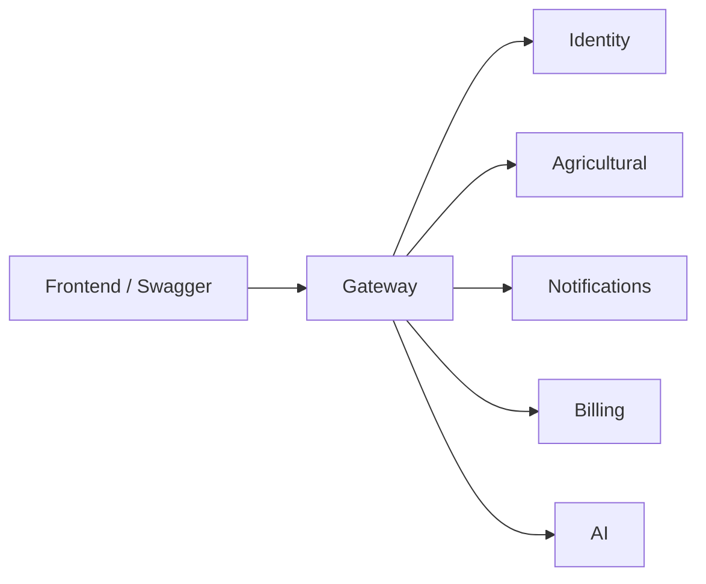

<div align="center">

# 🚪 AgroCloud API Gateway

**Un único punto de entrada para los microservicios de AgroCloud.**


[← Proyecto](../README.md) · [Contratos](../packages/README.md) · [Arquitectura](../docs/architecture/overview.md)

</div>

---

## ¿Qué hace?

Gateway recibe las solicitudes del cliente y las envía a **Identity, Agricultural, Notifications, Billing o AI**. Incluye Swagger centralizado, CORS explícito e identificadores de solicitud (`X-Request-Id`).



## Endpoints del Gateway

| Ruta | Descripción |
| :-- | :-- |
| `GET /` | Catálogo y enlaces de servicios. |
| `GET /health` | Estado del proceso Gateway. |
| `GET /docs` | Swagger UI interactivo. |
| `GET /openapi.json` | Especificación OpenAPI agregada. |
| `/api/v1/{servicio}/...` | Proxy a las rutas compatibles del servicio. |

**Prefijos:** `identity`, `agricultural`, `notifications`, `billing` y `ai`.

> Swagger presenta las operaciones orientadas a clientes. Para Billing y AI, el contrato centralizado incluye sus rutas de salud; los flujos de pago y de análisis para usuarios pasan por Identity y Agricultural.

## Ejecutar en local

**Requisitos:** Node.js 22 y servicios de destino disponibles.

Desde la raíz del repositorio:

```bash
npm ci
cp gateway/.env.example gateway/.env
npm run dev:gateway
```

El Gateway se inicia por defecto en **http://localhost:4000**.

**Accesos:** [Swagger](http://localhost:4000/docs) · [OpenAPI](http://localhost:4000/openapi.json) · [Health](http://localhost:4000/health)

Alternativamente, utiliza la configuración completa de [Docker Compose](../docs/local-development.md).

## Autenticación y seguridad

- **Usuarios:** JWT de Identity mediante `Authorization: Bearer` y botón **Authorize** de Swagger.
- **Cloud Run:** Gateway obtiene un ID token de su cuenta de servicio para invocar microservicios privados mediante `X-Serverless-Authorization`.
- **CORS:** `CORS_ORIGINS` acepta orígenes HTTP(S) exactos separados por comas; por defecto `http://localhost:3000`.
- **Protecciones:** se bloquean rutas `/internal` y se eliminan encabezados de identidad y claves internas enviados por clientes.

> **Pendiente de endurecimiento:** el proxy todavía puede reenviar otras rutas de Billing y AI aunque Swagger no las muestre. Antes de mantener Gateway público, aplicar listas de rutas permitidas y verificar la autorización de cada operación.

## Validación rápida

```bash
npm run build --workspace=@agrocloud/gateway
npm run test --workspace=@agrocloud/gateway
curl http://localhost:4000/health
```

Si modificas el Gateway o los contratos OpenAPI, **reconstruye su imagen**: la imagen Docker incluye `packages/contracts/openapi`.

---

<sub>AgroCloud · API Gateway · NestJS</sub>
