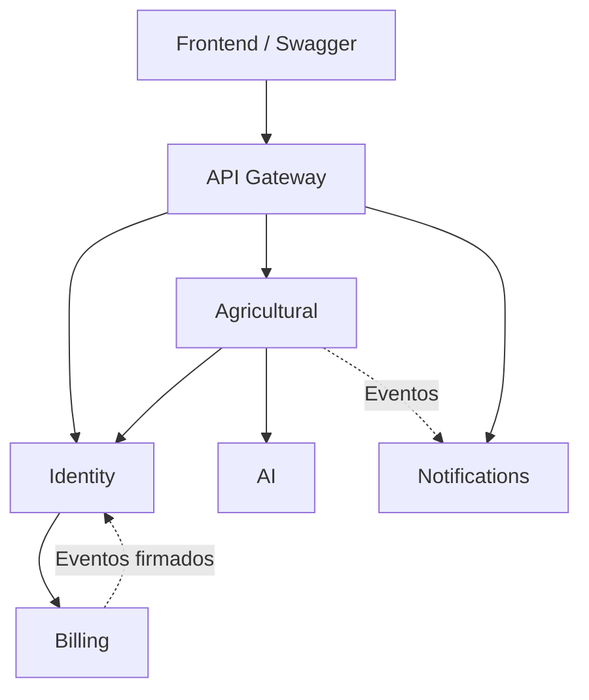

<div align="center">

# 🌿 AgroCloud · Microservicios

**Servicios independientes para gestionar identidad, operaciones agrícolas, inteligencia artificial, notificaciones y pagos.**


[**Proyecto principal**](../README.md) · [**Arquitectura**](../docs/architecture/overview.md) · [**Swagger Gateway**](../gateway/README.md)

</div>

---

## 📦 Servicios

| Servicio | Tecnología | Responsabilidad | Documentación |
| --- | --- | --- | --- |
| 🔐 **Identity** | Laravel 13 · PostgreSQL | Usuarios, empresas, JWT, roles, planes y cupos | [Ver README](ms-identity/README.md) |
| 🌱 **Agricultural** | Laravel 13 · PostgreSQL | Productores, lotes, inspecciones, evidencias y calidad | [Ver README](ms-agricultural/README.md) |
| 🧠 **AI** | FastAPI · Python 3.12 · PostgreSQL | Detección técnica de plagas mediante Roboflow | [Ver README](ms-ai/README.md) |
| 🔔 **Notifications** | NestJS 12 · PostgreSQL | Bandeja, preferencias, eventos y entregas | [Ver README](ms-notifications/README.md) |
| 💳 **Billing** | NestJS 12 · MongoDB | Órdenes, cargos Culqi, reembolsos y eventos | [Ver README](ms-billing/README.md) |

## 🏗️ Integración



**Gateway** es el punto de entrada del cliente. Las operaciones internas se comunican mediante HTTP autenticado y eventos firmados; cada servicio es propietario de sus datos.

## 🚀 Inicio local

Desde la **raíz del monorepo**, configura `.env` siguiendo [desarrollo local](../docs/local-development.md) y usa `compose.yaml`:

```bash
docker compose -f compose.yaml up -d --build
```

> Antes del primer arranque, aprovisiona bases, claves y migraciones según la guía. No uses `down -v` si necesitas conservar datos.

| Acceso local | URL |
| --- | --- |
| Swagger central | `http://localhost:4000/docs` |
| Gateway | `http://localhost:4000/health` |
| Identity | `http://localhost:8001/api/v1/health` |
| Agricultural | `http://localhost:8002/api/v1/health` |
| AI | `http://localhost:8003/health` |
| Notifications | `http://localhost:4002/health` |
| Billing | `http://localhost:4001/health` |

## 🔒 Convenciones

- **Usuarios:** JWT de Identity y permisos por empresa.
- **Servicios:** claves privadas, firmas de eventos y, en Cloud Run, ID tokens IAM.
- **Datos:** PostgreSQL independiente por servicio; Billing utiliza MongoDB.
- **Documentación:** contratos de cliente en [OpenAPI](../packages/README.md); no publicar claves internas en Swagger.

**Más información:** [Despliegue en Cloud Run](../docs/deployment/cloud-run.md) · [Estándar API](../docs/architecture/api-standard.md) · [Propiedad de datos](../docs/database/data-ownership.md)
