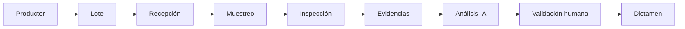

<div align="center">

# 🌱 AgroCloud Agricultural

**Gestión de calidad agrícola, desde la recepción de fruta hasta el dictamen final.**


[**Servicios**](../README.md) · [**Arquitectura**](../../docs/architecture/overview.md) · [**Swagger**](../../gateway/README.md)

</div>

---

## 🌾 Flujo de negocio



El servicio también gestiona catálogos, procedimientos de muestreo, incidencias, trazabilidad y reportes operativos.

## 📡 Endpoints principales

Base directa: `/api/v1` · A través del Gateway: `/api/v1/agricultural`

| Método | Ruta directa | Operación |
| --- | --- | --- |
| `GET / POST` | `/producers` | Consultar o registrar productores |
| `GET / POST` | `/lots` | Consultar o crear lotes |
| `POST` | `/lots/{lot}/reception` | Registrar recepción |
| `POST` | `/lots/{lot}/samplings` | Crear muestreo |
| `GET` | `/inspections` | Consultar inspecciones |
| `POST` | `/inspections/{id}/evidences` | Adjuntar evidencia |
| `POST` | `/evidences/{id}/analyze` | Solicitar análisis de IA |
| `POST` | `/inspections/{id}/validate` | Validar inspección |
| `POST` | `/inspections/{id}/decisions` | Emitir dictamen |
| `GET` | `/reports/summary` | Resumen operativo |

**Estado:** `/api/v1/health` y `/api/v1/ready`. Contrato completo: [openapi.yaml](openapi.yaml).

## 🔌 Integraciones

- **Identity:** valida JWT, permisos, empresa y cupos; no mantiene usuarios propios.
- **AI:** procesa imágenes y devuelve detecciones técnicas, sujetas a revisión humana.
- **Notifications:** recibe eventos firmados para generar avisos.
- **Cloudinary o almacenamiento privado:** conserva evidencias según la configuración.

> Cada consulta agrícola requiere un usuario activo con `id_empresa` positivo. Crear un lote exige además `Idempotency-Key` UUID.

## 🛠️ Desarrollo

Desde la raíz, después de configurar bases y credenciales:

```bash
docker compose -f compose.yaml run --rm --no-deps ms-agricultural php artisan migrate
docker compose -f compose.yaml run --rm --no-deps ms-agricultural php artisan db:seed
docker compose -f compose.yaml up -d ms-agricultural agricultural-worker
```

Las evidencias y el procesamiento de IA pueden requerir almacenamiento persistente, configuración externa y workers activos.

## 🔒 Operación segura

- Evidencias privadas; la descarga exige autorización.
- Permisos y aislamiento por empresa en cada operación.
- Detecciones automáticas **no equivalen** a una aprobación de calidad.
- `/ready` verifica configuración y esquema, **no** prueba la inferencia externa.

**Más información:** [Desarrollo local](../../docs/local-development.md) · [Propiedad de datos](../../docs/database/data-ownership.md)
