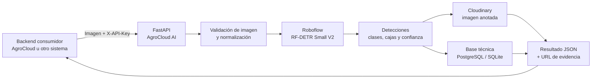

<div align="center">

# 🥑 AgroCloud AI

### Detección inteligente de plagas en palta con RF-DETR Small

**Un microservicio de visión por computadora para transformar fotografías agrícolas en información técnica verificable.**

[](https://www.python.org/)
[](https://fastapi.tiangolo.com/)
[](https://roboflow.com/)
[](https://github.com/ilanangelesrodriguez/agrocloud-ai-rfdetr/releases/tag/v2.1.0)

[](https://github.com/ilanangelesrodriguez/agrocloud-ai-rfdetr/actions/workflows/ci.yml)
[](https://cloudinary.com/)
[](https://www.postgresql.org/)
[](https://swagger.io/specification/)

[**🚀 Probar Swagger**](https://agrocloud-ai-rfdetr.vercel.app/docs) ·
[**📊 Ver dataset en Roboflow**](https://universe.roboflow.com/ilan-angeles/agrocloud-plagas-de-palta) ·
[**📦 Release v2.1.0**](https://github.com/ilanangelesrodriguez/agrocloud-ai-rfdetr/releases/tag/v2.1.0) ·
[**📖 Documentación técnica**](docs/API_Y_SWAGGER.md)

<sub>Proyecto de investigación y desarrollo · Inteligencia artificial aplicada a la agricultura · 2026</sub>

</div>

---

## 🌱 ¿Qué es AgroCloud AI?

**AgroCloud AI** es un microservicio independiente desarrollado en **Python + FastAPI** que analiza imágenes de palta (*Persea americana*) con un modelo de detección de objetos **RF-DETR Small**, entrenado y servido mediante **Roboflow**.

A partir de una fotografía, devuelve las **categorías detectadas**, su **nivel de confianza**, las **coordenadas de los objetos**, indicadores técnicos de calidad de imagen y una **imagen anotada almacenada en Cloudinary**.

Su objetivo es **apoyar** la inspección agrícola y postcosecha con evidencias trazables. **No sustituye la revisión de especialistas ni emite dictámenes fitosanitarios.**

### ✨ ¿Qué aporta?

| Capacidad | Beneficio |
| :--- | :--- |
| 🔎 **Detección de objetos** | Identifica regiones candidatas de interés en una imagen. |
| 🖼️ **Evidencia visual** | Genera fotografías anotadas y las almacena en Cloudinary. |
| 📏 **Resultados estructurados** | Entrega clases, confianza y *bounding boxes* en JSON. |
| 🧾 **Historial técnico** | Registra inferencias, tiempos y detecciones en una base de datos independiente. |
| 🔌 **Integración desacoplada** | Puede ser consumido por AgroCloud u otros sistemas a través de HTTP. |
| 🛡️ **Acceso controlado** | Protege los endpoints técnicos mediante `X-API-Key`. |

> [!IMPORTANT]
> El microservicio **solo realiza inferencia y registra información técnica**. No administra productores, empresas, lotes, inspecciones, validaciones humanas ni dictámenes de calidad. Esas responsabilidades pertenecen al sistema consumidor.

## 🧭 Contenido

- [Cómo funciona](#-cómo-funciona)
- [Modelo y conjunto de datos](#-modelo-y-conjunto-de-datos)
- [Tecnologías](#-tecnologías)
- [Comenzar en local](#-comenzar-en-local)
- [Uso de la API](#-uso-de-la-api)
- [Ejemplo de respuesta](#-ejemplo-de-respuesta)
- [Estructura del repositorio](#-estructura-del-repositorio)
- [Docker y despliegue](#-docker-y-despliegue)
- [Pruebas y calidad](#-pruebas-y-calidad)
- [Seguridad y limitaciones](#-seguridad-y-limitaciones)
- [Documentación y enlaces](#-documentación-y-enlaces)

## 🔄 Cómo funciona



**Flujo resumido:**

1. El cliente envía una imagen JPG, PNG o WEBP, o una URL autorizada de Cloudinary.
2. FastAPI valida el archivo y obtiene características técnicas de la imagen.
3. Roboflow ejecuta el modelo RF-DETR Small V2.
4. El servicio normaliza las predicciones, dibuja las anotaciones y sube la imagen resultante a **Cloudinary**.
5. Registra el resultado técnico en la base de datos y devuelve un JSON con su `request_id`.
6. El sistema consumidor decide cómo presentar, almacenar y validar humanamente esa evidencia.

> **Separación de responsabilidades:** en desarrollo y pruebas puede usarse **SQLite** para los registros técnicos. En producción se exige **PostgreSQL**. Las **imágenes anotadas se almacenan exclusivamente en Cloudinary**, no en el disco local.

## 🧠 Modelo y conjunto de datos

| Elemento | Detalle |
| :--- | :--- |
| Tarea | Detección de objetos (*object detection*) |
| Arquitectura | **RF-DETR Small** |
| Proveedor de inferencia | **Roboflow** |
| Identificador del modelo | `ilan-angeles/agrocloud-plagas-de-palta-2-rfdetr-small-t1` |
| Dataset | **AgroCloud – Plagas de Palta**, versión **2** |
| Imágenes | **175** |
| Anotaciones | **330** |
| Distribución | **123 Train · 35 Validation · 17 Test** |
| Categorías | **6** |

**Clases detectables:** `OXIDIA`, `CHINCHE_DAGBERTUS_MINENSIS`, `BICHO_DEL_CESTO`, `GRILLOS`, `QUEREZAS` y `ROEDORES`.

### Resultados de evaluación experimental

| Métrica (Test) | Resultado |
| :--- | ---: |
| **mAP@50** | **78.44 %** |
| mAP@50–95 | 56.45 % |
| Precision | 75.50 % |
| Recall | 75.70 % |

<sub>Fuente: [evaluación congelada de Roboflow V2](src/agrocloud_ai/resources/evaluation_v2.json), registrada el 31 de octubre de 2026. Estas cifras corresponden al conjunto de prueba, **no** al rendimiento productivo ni a una validación en campo.</sub>

> [!CAUTION]
> El conjunto de prueba contiene **17 imágenes** y **no incluye anotaciones de `CHINCHE_DAGBERTUS_MINENSIS`**; por tanto, su desempeño en Test no es evaluable. También es necesario comprobar la independencia entre particiones y el origen real o sintético de las imágenes. La confianza del modelo **no equivale** a la probabilidad clínica o agronómica de una plaga.

Consulta el [dataset público en Roboflow Universe](https://universe.roboflow.com/ilan-angeles/agrocloud-plagas-de-palta) y la [evaluación técnica del proyecto](docs/API_Y_SWAGGER.md).

## 🧰 Tecnologías

| Capa | Tecnología |
| :--- | :--- |
| API y documentación | Python 3.11/3.12 · FastAPI · Swagger/OpenAPI |
| Inteligencia artificial | RF-DETR Small · Roboflow Inference API |
| Procesamiento de imágenes | Pillow |
| Almacenamiento de evidencias | Cloudinary |
| Base de datos | SQLAlchemy · PostgreSQL en producción; SQLite para desarrollo/pruebas |
| Migraciones | Alembic |
| Pruebas y automatización | pytest · pytest-cov · GitHub Actions |
| Contenedores | Docker · Docker Compose |

## 🚀 Comenzar en local

### Requisitos

- **Python 3.11 o 3.12** y `pip`.
- Una clave de acceso de **Roboflow** con permiso de inferencia al modelo.
- Una cuenta de **Cloudinary** para almacenar las imágenes anotadas.
- Una clave propia para autenticar las llamadas a la API.
- Opcional: PostgreSQL si deseas probar un entorno equivalente al de producción.

### 1. Clonar e instalar

```bash
git clone https://github.com/ilanangelesrodriguez/agrocloud-ai-rfdetr.git
cd agrocloud-ai-rfdetr

python -m venv .venv
```

**Linux / macOS:**

```bash
source .venv/bin/activate
python -m pip install -e '.[dev]'
```

**Windows PowerShell:**

```powershell
.venv\Scripts\Activate.ps1
python -m pip install -e '.[dev]'
```

### 2. Configurar variables de entorno

Crea un archivo **`.env`** en la raíz del proyecto. Para comenzar en desarrollo, puedes usar esta plantilla **con valores de ejemplo** y sustituir las credenciales:

```dotenv
APP_ENV=development
SERVICE_API_KEY=REEMPLAZA_CON_TU_CLAVE_DE_SERVICIO
ROBOFLOW_API_KEY=REEMPLAZA_CON_TU_CLAVE_DE_ROBOFLOW

ROBOFLOW_MODE=model
ROBOFLOW_WORKSPACE=ilan-angeles
ROBOFLOW_MODEL_ID=ilan-angeles/agrocloud-plagas-de-palta-2-rfdetr-small-t1
ROBOFLOW_TRAINED_MODEL_ID=ilan-angeles/agrocloud-plagas-de-palta-2-rfdetr-small-t1

CLOUDINARY_URL=cloudinary://API_KEY:API_SECRET@TU_CLOUD_NAME
CLOUDINARY_CLOUD_NAME=TU_CLOUD_NAME
CLOUDINARY_FOLDER=agrocloud/ai/rfdetr-v2

DATABASE_URL=sqlite:///./data/agrocloud_ai.sqlite3
AUTO_CREATE_TABLES=true

MIN_CONFIDENCE=0.20
HIGH_CONFIDENCE=0.75
MAX_IMAGE_MB=3
MAX_BATCH_SIZE=5
```

> [!NOTE]
> El código requiere **Cloudinary incluso en desarrollo**. La configuración `ROBOFLOW_MODE=model` consume el modelo entrenado directamente; cambiar a `workflow` requiere tener un workflow compatible configurado. **No subas `.env` ni ninguna credencial al repositorio.**

### 3. Ejecutar la API

```bash
uvicorn agrocloud_ai.main:app --reload --host 127.0.0.1 --port 8000
```

Abre en tu navegador:

| Recurso | Dirección local |
| :--- | :--- |
| **Swagger UI** | [http://localhost:8000/docs](http://localhost:8000/docs) |
| **ReDoc** | [http://localhost:8000/redoc](http://localhost:8000/redoc) |
| **OpenAPI JSON** | [http://localhost:8000/openapi.json](http://localhost:8000/openapi.json) |
| **Estado básico** | [http://localhost:8000/health](http://localhost:8000/health) |
| **Configuración + BD** | [http://localhost:8000/ready](http://localhost:8000/ready) |

`/ready` comprueba la configuración y la conectividad de base de datos, **no realiza una inferencia real contra Roboflow**.

## 📡 Uso de la API

Todas las rutas bajo `/api/v1/` requieren la cabecera `X-API-Key`. En Swagger, pulsa **Authorize** e introduce la clave configurada en `SERVICE_API_KEY`.

### Endpoints principales

| Método | Ruta | Descripción |
| :--- | :--- | :--- |
| `POST` | `/api/v1/analyses/file` | Detectar objetos en una fotografía subida. |
| `POST` | `/api/v1/analyses/url` | Analizar una imagen ya alojada en la cuenta Cloudinary autorizada. |
| `POST` | `/api/v1/analyses/batch` | Analizar un lote de imágenes secuencialmente. |
| `GET` | `/api/v1/inferences` | Consultar el historial técnico paginado. |
| `GET` | `/api/v1/inferences/{request_id}` | Recuperar el resultado JSON de una inferencia. |
| `GET` | `/api/v1/inferences/{request_id}/image` | Redirigir a la imagen anotada de Cloudinary (`307`). |
| `GET` | `/api/v1/model` | Consultar el modelo activo y su configuración pública. |
| `GET` | `/api/v1/model/evaluation` | Consultar la evaluación experimental congelada. |
| `GET` | `/api/v1/model/classes` | Revisar resultados por categoría en Test. |
| `GET` | `/api/v1/model/confusion-matrix` | Consultar la matriz de confusión de Test. |
| `GET` | `/api/v1/stats/overview` | Consultar métricas operativas del servicio. |

Otras rutas de estadísticas están documentadas en [API y Swagger](docs/API_Y_SWAGGER.md).

### Analizar una fotografía

```bash
curl -X POST "http://localhost:8000/api/v1/analyses/file" \
  -H "X-API-Key: TU_SERVICE_API_KEY" \
  -F "file=@palta.jpg"
```

> Para probar la versión desplegada, cambia `http://localhost:8000` por la URL de tu servicio. El archivo se envía como `multipart/form-data`; no necesitas definir manualmente `Content-Type` en `curl`.

### Analizar una URL de Cloudinary

```bash
curl -X POST "http://localhost:8000/api/v1/analyses/url" \
  -H "X-API-Key: TU_SERVICE_API_KEY" \
  -H "Content-Type: application/json" \
  -d '{"image_url":"https://res.cloudinary.com/TU_CLOUD_NAME/image/upload/v1/palta.jpg"}'
```

La URL debe corresponder a la cuenta Cloudinary permitida por la configuración; la API rechaza URLs externas no autorizadas.

### Recuperar la imagen anotada

```bash
curl -i \
  -H "X-API-Key: TU_SERVICE_API_KEY" \
  "http://localhost:8000/api/v1/inferences/TU_REQUEST_ID/image"
```

El endpoint devuelve **HTTP `307`** con una cabecera `Location` hacia Cloudinary. No utiliza almacenamiento local de imágenes.

## 🧪 Ejemplo de respuesta

La estructura siguiente es **ilustrativa** y contiene valores de muestra:

```json
{
  "request_id": "ee464cc7-e183-41d8-a27c-dbc633cb6a76",
  "status": "completed",
  "model_id": "ilan-angeles/agrocloud-plagas-de-palta-2-rfdetr-small-t1",
  "dataset_version": 2,
  "model_family": "RF-DETR Small",
  "threshold": 0.2,
  "detections": [
    {
      "id": "det-0",
      "class_name": "BICHO_DEL_CESTO",
      "confidence": 0.87,
      "box": { "x1": 131, "y1": 213, "x2": 218, "y2": 411 },
      "review_priority": "high"
    }
  ],
  "summary": {
    "total_detections": 1,
    "by_class": { "BICHO_DEL_CESTO": 1 },
    "mean_confidence": 0.87,
    "max_confidence": 0.87,
    "conclusion": "Objetos candidatos detectados; validar manualmente"
  },
  "annotated_image_url": "https://res.cloudinary.com/TU_CLOUD_NAME/image/upload/v1/imagen-anotada.jpg",
  "requires_human_review": true
}
```

La respuesta completa también incluye `trained_model_id`, fecha, calidad de imagen, huella SHA-256, cajas normalizadas y tiempos de ejecución. Consulta el esquema exacto en `/docs`.

## 🗂️ Estructura del repositorio

```text
agrocloud-ai-rfdetr/
├── src/agrocloud_ai/
│   ├── api/
│   │   ├── routes/          # Análisis, modelo, inferencias, estadísticas y salud
│   │   └── dependencies.py  # Inyección de proveedor y almacenamiento
│   ├── application/        # Casos de uso y contratos
│   ├── core/               # Configuración, autenticación y errores
│   ├── domain/             # Detecciones, procesamiento y evaluación
│   ├── infrastructure/
│   │   ├── inference/      # Adaptador de Roboflow
│   │   ├── persistence/    # SQLAlchemy e historial técnico
│   │   └── storage/        # Cloudinary y validación de URL remota
│   ├── resources/          # Snapshots de evaluación del modelo
│   └── main.py             # Punto de entrada FastAPI
├── alembic/                # Migraciones de la base técnica
├── docs/                   # Arquitectura, API, integración y despliegue
├── tests/                  # Pruebas automatizadas
├── .github/workflows/      # Integración continua
├── Dockerfile
├── docker-compose.yml
└── pyproject.toml
```

## 🐳 Docker y despliegue

### Crear y ejecutar un contenedor

```bash
docker build -t agrocloud-ai-rfdetr:2.1.0 .
docker run --rm --env-file .env -p 8000:8000 agrocloud-ai-rfdetr:2.1.0
```

También puedes ejecutar:

```bash
docker compose up --build
```

El `Dockerfile` ejecuta Uvicorn en el puerto `8000`. El contenedor necesita las variables de entorno y una base de datos configurada.

### Producción

Para un entorno de producción:

1. Configura `APP_ENV=production` y una `SERVICE_API_KEY` robusta (mínimo 24 caracteres según la validación actual).
2. Utiliza una base de datos **PostgreSQL independiente** para el historial técnico.
3. Configura `AUTO_CREATE_TABLES=false` y ejecuta las migraciones **antes** de iniciar el servicio:

   ```bash
   alembic upgrade head
   ```

4. Agrega las credenciales de Roboflow y Cloudinary como **secretos de entorno**, nunca en la imagen Docker.
5. Verifica `/health`, `/ready` y una inferencia real con una imagen de prueba.

> [!IMPORTANT]
> El proyecto incluye soporte para despliegue mediante contenedor. La distribución del código y el [Release v2.1.0](https://github.com/ilanangelesrodriguez/agrocloud-ai-rfdetr/releases/tag/v2.1.0) son independientes del despliegue del servicio en Vercel u otra plataforma.

Consulta la [guía de despliegue](docs/DESPLIEGUE.md) para información complementaria.

## ✅ Pruebas y calidad

El repositorio integra **GitHub Actions** con pruebas automatizadas en **Python 3.11 y 3.12**, compilación sintáctica y cobertura con `pytest-cov`.

```bash
python -m compileall -q src
python -m pytest --cov=agrocloud_ai --cov-report=term-missing
```

Las pruebas usan proveedores simulados; no deben realizar inferencias reales ni subir imágenes a Cloudinary. Puedes consultar las ejecuciones en [GitHub Actions](https://github.com/ilanangelesrodriguez/agrocloud-ai-rfdetr/actions/workflows/ci.yml).

## 🔐 Seguridad y limitaciones

- **Autenticación:** los endpoints `/api/v1/*` están pensados para comunicación **backend a backend** mediante `X-API-Key`. No expongas esta clave en el navegador.
- **Datos de negocio:** el servicio no recibe IDs de empresa, lote o inspección; el backend consumidor conserva esas asociaciones.
- **Imágenes:** las URLs estándar que devuelve Cloudinary pueden ser públicas. Si necesitas evidencia privada, debes configurar mecanismos adicionales de acceso y entrega segura.
- **Trazabilidad:** el `request_id` identifica la ejecución técnica, pero no otorga permisos sobre los datos del sistema consumidor.
- **Resultados experimentales:** los indicadores publicados no garantizan el mismo rendimiento con fotografías de campo o condiciones nuevas.
- **Revisión humana:** ninguna predicción reemplaza la evaluación de personal especializado.

## 📚 Documentación y enlaces

| Recurso | Enlace |
| :--- | :--- |
| API y Swagger | [docs/API_Y_SWAGGER.md](docs/API_Y_SWAGGER.md) |
| Arquitectura del microservicio | [docs/ARQUITECTURA.md](docs/ARQUITECTURA.md) |
| Integración HTTP desacoplada | [docs/INTEGRACION_HTTP.md](docs/INTEGRACION_HTTP.md) |
| Guía de despliegue | [docs/DESPLIEGUE.md](docs/DESPLIEGUE.md) |
| Dataset en Roboflow Universe | [AgroCloud – Plagas de Palta](https://universe.roboflow.com/ilan-angeles/agrocloud-plagas-de-palta) |
| Release oficial | [v2.1.0](https://github.com/ilanangelesrodriguez/agrocloud-ai-rfdetr/releases/tag/v2.1.0) |
| Swagger del servicio desplegado | [agrocloud-ai-rfdetr.vercel.app/docs](https://agrocloud-ai-rfdetr.vercel.app/docs) |

---

<div align="center">

### 🌿 Inteligencia artificial al servicio de una agricultura más informada

**AgroCloud AI** · Investigación y desarrollo experimental · 2026

Desarrollado por **Ilan Angeles Rodríguez**

[Repositorio](https://github.com/ilanangelesrodriguez/agrocloud-ai-rfdetr) · [Roboflow Universe](https://universe.roboflow.com/ilan-angeles/agrocloud-plagas-de-palta) · [Releases](https://github.com/ilanangelesrodriguez/agrocloud-ai-rfdetr/releases)

</div>
