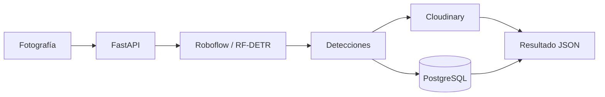

<div align="center">

# 🥑 AgroCloud AI

**Análisis técnico de fotografías de palta mediante detección de objetos.**


[**Servicios**](../README.md) · [**Gateway**](../../gateway/README.md) · [**Roboflow**](https://universe.roboflow.com/ilan-angeles/agrocloud-plagas-de-palta)

</div>

---

## 🧠 ¿Qué hace?

Recibe fotografías agrícolas y devuelve **detecciones**, clase, confianza y coordenadas (*bounding boxes*). Utiliza Roboflow para inferencia, PostgreSQL para datos técnicos y Cloudinary para imágenes anotadas.

**No gestiona** empresas, productores, lotes ni dictámenes. La validación final corresponde a Agricultural y a sus usuarios autorizados.

## 🔄 Flujo de análisis



## 📡 Endpoints principales

| Método | Ruta directa | Función |
| --- | --- | --- |
| `POST` | `/api/v1/analyses/file` | Analizar una imagen |
| `POST` | `/api/v1/analyses/url` | Analizar imagen alojada en Cloudinary |
| `POST` | `/api/v1/analyses/batch` | Analizar varias imágenes |
| `GET` | `/health` | Estado del proceso |
| `GET` | `/ready` | Configuración y conexión a base de datos |

La API tiene **Swagger propio** en `/docs`, ReDoc en `/redoc` y contrato en `/openapi.json`. Las operaciones de análisis requieren `X-API-Key`.

**Archivos:** JPG, PNG o WebP; límite configurado por `MAX_IMAGE_MB` (3 MiB en `.env.example`).

## 🛠️ Desarrollo

Desde `services/ms-ai`, con Python 3.12 y PostgreSQL configurado:

```bash
python -m venv .venv
source .venv/bin/activate
pip install -e ".[postgres]"
# Configurar .env antes de iniciar
alembic upgrade head
uvicorn agrocloud_ai.main:app --reload --port 8000
```

Las credenciales se definen en [`.env.example`](.env.example): `DATABASE_URL`, `SERVICE_API_KEY`, `ROBOFLOW_API_KEY` y Cloudinary. También puedes usar el [Compose principal](../../docs/local-development.md).

## 🔐 Límites y operación

- `/ready` comprueba configuración y PostgreSQL, **no** una inferencia real.
- Las claves de Roboflow y Cloudinary solo deben existir en el backend.
- Una detección automática es evidencia técnica; **no reemplaza el dictamen humano**.
- En Cloud Run, mantén el servicio privado y prueba inferencia extremo a extremo antes de darlo por validado.

**Más información:** [Arquitectura](../../docs/architecture/overview.md) · [Cloud Run](../../docs/deployment/cloud-run.md)
