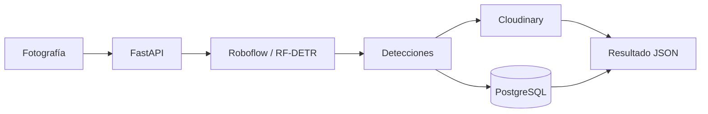

<div align="center">

# 🥑 AgroCloud AI

**Análisis técnico de fotografías de palta mediante detección de objetos.**


[**Servicios**](../README.md) · [**Gateway**](../../gateway/README.md) · [**Documentación técnica**](docs/README.md) · [**Roboflow**](https://universe.roboflow.com/ilan-angeles/agrocloud-plagas-de-palta)

</div>

---

## 🧠 ¿Qué hace?

Recibe fotografías agrícolas y devuelve **detecciones**, clases, confianza y coordenadas (*bounding boxes*). Utiliza Roboflow para inferencia, PostgreSQL para datos técnicos y Cloudinary para imágenes anotadas.

**No gestiona** empresas, productores, lotes ni dictámenes. La validación final corresponde a Agricultural y a sus usuarios autorizados.

## 🔄 Flujo de análisis



## 📡 Endpoints principales

| Método | Ruta directa | Función |
| --- | --- | --- |
| `POST` | `/api/v1/analyses/file` | Analizar una imagen |
| `POST` | `/api/v1/analyses/url` | Analizar imagen autorizada de Cloudinary |
| `POST` | `/api/v1/analyses/batch` | Analizar varias imágenes |
| `GET` | `/health` | Estado del proceso |
| `GET` | `/ready` | Configuración y base de datos |

AI ofrece **Swagger** en `/docs`, ReDoc en `/redoc` y contrato OpenAPI en `/openapi.json`. Sus operaciones protegidas usan `X-API-Key`.

**Formatos:** JPG, PNG o WebP; límite predeterminado de 3 MiB.

## 🛠️ Desarrollo

Desde `services/ms-ai`, con Python 3.12 y un entorno de base de datos configurado:

```bash
python -m venv .venv
source .venv/bin/activate
pip install -e ".[postgres]"
# Configura .env antes de iniciar
alembic upgrade head
uvicorn agrocloud_ai.main:app --reload --port 8000
```

Configura [`.env.example`](.env.example) con la base de datos, `SERVICE_API_KEY`, Roboflow y Cloudinary. También puedes utilizar el [Compose principal](../../docs/local-development.md).

## 📚 Documentación

| Guía | Uso |
| :-- | :-- |
| [API y Swagger](docs/API_Y_SWAGGER.md) | Consultar y probar endpoints |
| [Arquitectura](docs/ARQUITECTURA.md) | Capas y propiedad de datos |
| [Integración HTTP](docs/INTEGRACION_HTTP.md) | Consumir AI desde Agricultural |
| [Despliegue](docs/DESPLIEGUE.md) | Alembic, Docker y Cloud Run |

## 🔐 Consideraciones

- `/ready` no realiza una inferencia real con Roboflow.
- Las claves privadas permanecen exclusivamente en el backend.
- Las detecciones son evidencia técnica; **no sustituyen el dictamen humano**.
- En Cloud Run, mantén AI privado y prueba el flujo completo antes de declararlo listo para producción.

[**Arquitectura general**](../../docs/architecture/overview.md) · [**Cloud Run**](../../docs/deployment/cloud-run.md)
