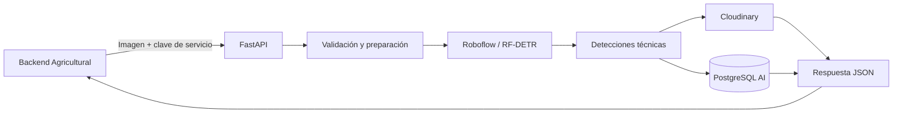

# 🏗️ Arquitectura · AgroCloud AI

**Un microservicio independiente dedicado a inferencias sobre imágenes.** No administra usuarios, empresas, lotes, inspecciones ni dictámenes.

## Flujo

| Capa | Responsabilidad |
| :-- | :-- |
| `api/` | Rutas FastAPI y validaciones de entrada |
| `core/` | Configuración, seguridad y excepciones |
| `domain/` | Clases, cajas, confianza y resultados |
| `application/` | Ejecución del análisis y estadísticas |
| `infrastructure/inference/` | Comunicación con Roboflow |
| `infrastructure/storage/` | Imágenes anotadas en Cloudinary |
| `infrastructure/persistence/` | Registro técnico de inferencias |

## Propiedad de datos

La base de AI registra sus propias ejecuciones y objetos detectados mediante `ai_inference_runs` y `ai_detected_objects`.

- **AI** conserva `request_id`, predicciones, tiempos y referencias técnicas.
- **Agricultural** conserva la evidencia original, su relación con la empresa y las decisiones humanas.
- No se comparten tablas ni claves foráneas entre ambos servicios.

**Persistencia:** SQLite puede utilizarse en desarrollo; **PostgreSQL es obligatorio en producción**. Las imágenes anotadas se almacenan en Cloudinary en producción.

## Límites

- La IA propone detecciones; **no emite dictámenes** ni sustituye al inspector.
- Los endpoints de historial y estadísticas abarcan el servicio técnico completo: son para operadores/backend de confianza.
- La integración en Cloud Run requiere **IAM (ID token)** y, además, **`X-API-Key`** en las operaciones de AI.
- `/ready` valida la configuración y la base de datos, no el rendimiento ni la disponibilidad real de Roboflow.

[← Índice AI](README.md) · [Despliegue](DESPLIEGUE.md)
