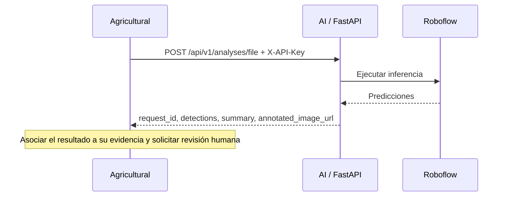

# 🔗 Integración HTTP · Agricultural ↔ AI

Agricultural es el **consumidor de negocio**; AI es el **proveedor de inferencias**. Se comunican por HTTP sin compartir bases de datos.

## Secuencia

1. Agricultural obtiene una fotografía autorizada de la evidencia.
2. Envía el archivo a `POST /api/v1/analyses/file` o una URL de Cloudinary permitida a `/api/v1/analyses/url`.
3. AI devuelve coordenadas, clases, puntuaciones y un `request_id` técnico.
4. Agricultural registra los resultados en sus propias tablas y permite la revisión del inspector.

**No enviar** IDs de empresa, productor, lote o inspección a AI: el vínculo se mantiene en Agricultural.

## Autenticación

| Entorno | Requisito |
| :-- | :-- |
| Local | `X-API-Key` compartida por los backends |
| Cloud Run privado | ID token de Google para invocar AI **más** `X-API-Key` para autorizar la operación |

La clave privada nunca se entrega al frontend. Si se utiliza `Authorization` para la identidad del cliente, mantener separadas las credenciales de infraestructura mediante `X-Serverless-Authorization`.

## Contrato de respuesta

- `detections`: clase, confianza y caja delimitadora.
- `summary`: recuento y resumen técnico.
- `request_id`: identificador propio de la inferencia.
- `annotated_image_url`: imagen anotada, cuando esté disponible.
- `requires_human_review`: indica que requiere revisión de una persona.

**No existe** compatibilidad con la ruta anterior `/api/v1/detect`. La aplicación consumidora debe utilizar `/api/v1/analyses/file` o `/url`.

> Los endpoints `/api/v1/stats/*` no ofrecen estadísticas por empresa o lote. Esos reportes deben calcularse en Agricultural.

[← Índice AI](README.md) · [API y Swagger](API_Y_SWAGGER.md)
