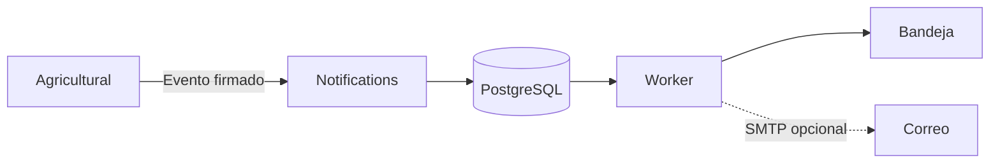

<div align="center">

# 🔔 AgroCloud Notifications

**Notificaciones empresariales, bandeja personal y preferencias de entrega.**


[**Servicios**](../README.md) · [**Swagger**](../../gateway/README.md) · [**Estándar API**](../../docs/architecture/api-standard.md)

</div>

---

## ✉️ Funciones

- Bandeja por usuario y empresa, con avisos leídos y no leídos.
- Preferencias de notificación por cuenta.
- Recepción de eventos firmados con deduplicación.
- Worker de procesamiento y correo opcional mediante SMTP.

## 📡 Endpoints

| Método | Ruta del Gateway | Uso |
| --- | --- | --- |
| `GET` | `/api/v1/notifications` | Consultar bandeja |
| `GET` | `/api/v1/notifications/unread-count` | Contar pendientes |
| `PATCH` | `/api/v1/notifications/read-all` | Marcar todos como leídos |
| `PATCH` | `/api/v1/notifications/{id}/read` | Marcar uno como leído |
| `GET` | `/api/v1/notifications/preferences` | Consultar preferencias |
| `PUT` | `/api/v1/notifications/preferences` | Actualizar preferencias |

La API directa sirve las preferencias en `/api/v1/notification-preferences`. Disponibilidad: `/health` y `/ready`. [Contrato OpenAPI](openapi.yaml).

## 🔁 Flujo de eventos



Los receptores internos admiten eventos de Agricultural y están preparados para Identity/Billing cuando exista un productor de eventos confiable. No hacen públicas las credenciales de eventos.

## 🛠️ Desarrollo

Desde la raíz del monorepo, con `.env` configurado:

```bash
# Esquema inicial
docker compose -f compose.yaml run --rm --no-deps ms-notifications node scripts/migrate.mjs

# API y worker
docker compose -f compose.yaml up -d ms-notifications notifications-worker
```

En ejecución manual, instala dependencias desde la raíz (`npm ci`); utiliza el workspace `@agrocloud/ms-notifications`.

## 🔐 Seguridad y producción

- Usa un JWT válido de Identity; verifica usuario, empresa y permisos.
- En Cloud Run, las llamadas privadas a Identity requieren además un **ID token IAM**.
- `MAIL_ENABLED=false` permite procesar bandeja, pero **no envía correos**.
- El worker necesita ejecución persistente o programación adecuada en un entorno serverless.

**Documentación:** [Inicio local](../../docs/local-development.md) · [Cloud Run](../../docs/deployment/cloud-run.md)
